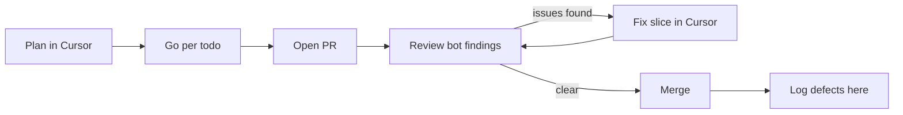

# Agent workflow

Record of AI use on this task (issues [#1](https://github.com/kiu95/polling-system/issues/1)–[#5](https://github.com/kiu95/polling-system/issues/5), PRs [#6](https://github.com/kiu95/polling-system/pull/6)–[#11](https://github.com/kiu95/polling-system/pull/11)). Tools: **Cursor** (plan mode, then implementation agents, local machine) and a **scmp-polling PR review** bot that runs when a PR is opened or updated on GitHub. Models: Claude Sonnet 5.5 for planning, Grok 4.7 for code, Composer 2.5 for docs and opening PRs.

## Prompt strategy

One cycle, repeated per issue and per PR:

- **The spec and GitHub issues set scope.** Each slice started with "plan on issue #N": fetch the issue, read the neighbouring issues, then plan. The assistant did not choose the stack. I locked it before the scaffold: Vite React TS, Fastify, SQLite (`better-sqlite3`), Vitest, npm workspaces.
- **Lock the plan, then wait for "go".** Assumptions (ports, schema, seed, what stays out) were written into the plan. Implementation started only after an explicit go.
- **Slice by todo.** Prompts like `go 1st todo item`, `work 2nd - 5th todo`, `work remaining todo` stopped the assistant at the named todo. Commits were split per todo.
- **Check the machine, not the plan.** Every slice ran `npm run lint`, `npm run typecheck` and `npm test`. Slices also ran `curl` against the API, a browser check (vote, reload, forced `500` rollback, two tabs for live results) and, for #5, `docker compose up --build` with a vote surviving `stop` / `start`.
- **PR review loop.** I pasted each review finding into chat, scoped a fix slice, and had the assistant implement it. The WebSocket choice for #4 (the issue text said HTTP polling) and Tailwind for #3 were my decisions made in plan mode.
- **Keep this file current.** A workspace rule requires each slice to append strategy notes and any assistant-caused defect here.
- **Out of scope throughout:** real auth (`x-user-id` is a mock), CI workflow, and anything not named in the current todo.

## Defects the assistant introduced

### `better-sqlite3` 11 does not install on Node 24

Symptom: `npm install` on Node 24.22.1 found no prebuild and failed to compile (`'climits' file not found`). Cause: the plan assumed Node 22 and pinned `^11.8.1`. Fix: the assistant moved the pin to `^12.6.2` (installed 12.11.1, has a Node 24 prebuild) without stopping to ask, although the plan said to ask before leaving `better-sqlite3`. Health and poll checks passed afterwards.

### Instability ran before the duplicate-vote check

Symptom: with instability on, a second vote from the same user could return `500 simulated_failure` instead of `409 already_voted`. A bad option or missing poll had the same gap. Cause: `POST /vote` called `applyVoteInstability` before `insertVote`. Fix: `assessVote` first; instability only when the insert would otherwise succeed; a test covers already-voted plus forced failure. Caught by the PR #7 review; the assistant fixed it.

### Pending overlay used the poll total

Symptom: while a vote was pending, another user's vote raised `total` and the local +1 disappeared. Cause: `deriveVoteView` treated any higher `total` as "my vote is already counted". Fix: baseline is the chosen option's count. Caught by the PR #9 review; the assistant fixed it.

### Snapshot send ran before socket cleanup

Symptom: a throw from the initial `socket.send` left the socket in the hub until a later broadcast. Cause: `close` / `error` listeners were registered after the send. Fix: register them first and remove the socket if the send throws. PR #9 review; the assistant fixed it.

### First paint said "Reconnecting"

Symptom: header showed **Reconnecting** before the socket ever opened. Cause: the hook's initial status was `reconnecting`. Fix: initial status `connecting`, label **Connecting**. PR #9 review; the assistant fixed it.

### `injectWS` hung until `app.ready()`

Symptom: both `/ws` tests timed out at 5000ms. Cause: `@fastify/websocket`'s `injectWS` does not call `ready()`, so the upgrade never completed. Fix: `await app.ready()` in `beforeEach`. The assistant fixed it after the test run.

### Vite listened on IPv6 only

Symptom: `http://127.0.0.1:5173/` refused connections while `localhost` worked. Cause: Vite's default bind on this Mac was `[::1]` only, but the README documents `127.0.0.1`. Fix: `server.host: '127.0.0.1'`. The assistant found it by curling the documented URL.

### SQLite sidecar files committed

Symptom: `git status` showed tracked `poll.db-shm` and `poll.db-wal`. Cause: WAL files were staged before `.gitignore` covered them. Fix: ignore both patterns and `git rm --cached`. The assistant fixed it when opening the PR for #1.

### `biome.json` used a removed key

Symptom: `biome check` failed with "unknown key `ignore`". Cause: Biome 2.6 expects `files.includes` with negated globs. Fix: `npx biome migrate --write`. The assistant fixed it.

### Production `npm ci` ran Husky and failed the Docker build

Symptom: `docker compose up --build` died with `husky: not found` in the server runtime stage. Cause: root `prepare` always runs `husky`, and `npm ci --omit=dev` does not install it. Fix: `npm ci --omit=dev --ignore-scripts`, then `npm rebuild better-sqlite3`. The assistant fixed it in the same slice.

### Non-root API could not write the existing SQLite volume

Symptom: after dropping to uid 1000, `POST /vote` returned `500` (`SQLITE_READONLY`). Cause: the entrypoint ran `chown node:node /data`, which changes the directory only; the root-owned `poll.db` stayed read-only. Fix: `chown -R node:node /data` before `gosu`. A vote then survived `stop` / `start`. PR #10 review slice; the assistant fixed it.

### Empty vote read reported as "not saved"

Symptom: after a client timeout, one `GET /vote` with `optionId: null` told the user the vote failed and allowed a retry, while the original `POST` could still insert. Cause: reconcile treated a missing row as confirmed failure; the timeout does not cancel the server handler. Fix: re-read up to four times, 1s apart, before showing the unconfirmed message. Caught by the PR #11 review; the assistant fixed it.
